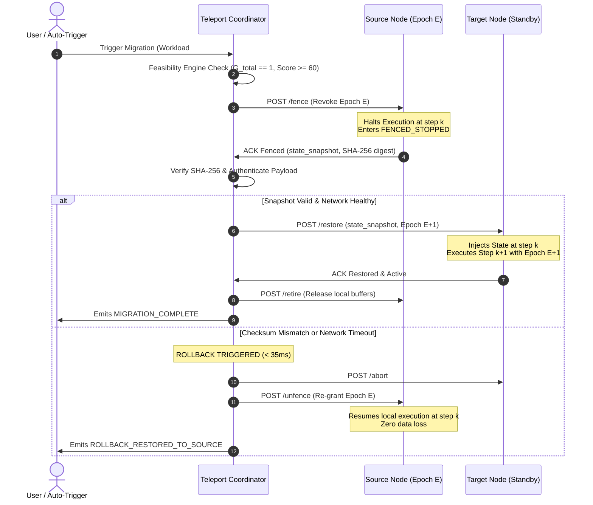

# Core Specification: Feasibility Engine & Monotonic Epoch Fencing

---

## 1. Feasibility Engine Mathematical Model

The Feasibility Engine evaluates whether a workload running on `Source` can safely migrate to `Candidate Target`. It operates in two sequential stages:

### 1.1 Stage 1: Hard Compatibility Gates ($G_{\text{total}} \in \{0, 1\}$)
All individual gates must evaluate to `1` (PASS) for live migration to be considered viable:
$$G_{\text{total}} = G_{\text{workload\_type}} \times G_{\text{ISA\_compat}} \times G_{\text{runtime\_compat}} \times G_{\text{RAM\_headroom}} \times G_{\text{network\_viable}}$$

#### Gate Definitions:
1. **$G_{\text{workload\_type}}$ (Checkability Gate)**:
   - Evaluates whether the workload runtime is checkpointable.
   - For `wasm_portable` or `deterministic_state`: $G_{\text{workload\_type}} = 1$.
   - For `gpu_locked` (e.g., local CUDA context) or `unpinned_hardware`: $G_{\text{workload\_type}} = 0$.
   - *Failure Reason*: `"Workload is bound to local hardware/GPU descriptor; cannot be checkpointed."`
2. **$G_{\text{ISA\_compat}}$ (Instruction Set Architecture Match)**:
   - For `wasm_portable`: $G_{\text{ISA\_compat}} = 1$ across all target architectures (`x86_64`, `arm64`).
   - For `container_criu`:
     $$G_{\text{ISA\_compat}} = \begin{cases} 1 & \text{if } \text{Source}_{\text{arch}} == \text{Target}_{\text{arch}} \\ 0 & \text{if } \text{Source}_{\text{arch}} \ne \text{Target}_{\text{arch}} \end{cases}$$
   - *Failure Reason*: `"ISA Mismatch: Native container compiled for x86_64 cannot restore on arm64 host."`
3. **$G_{\text{runtime\_compat}}$ (Target Runtime Support)**:
   - Checks if Target node supports the required execution runtime (`wasm`, `node`, `container_engine`).
   - *Failure Reason*: `"Target device lacks required runtime engine."`
4. **$G_{\text{RAM\_headroom}}$ (Memory Headroom Gate)**:
   - Requires:
     $$\text{Target}_{\text{FreeRAM\_MB}} \ge \text{Workload}_{\text{Footprint\_MB}} \times 1.25$$
   - *Failure Reason*: `"Insufficient memory: Target has 240 MB free, but workload requires 350 MB + safety headroom."`
5. **$G_{\text{network\_viable}}$ (Connectivity Gate)**:
   - Target must have an active heartbeat within the last 3000ms and RTT $< 800\text{ms}$.
   - *Failure Reason*: `"Target node unreachable or heartbeat expired."`

---

### 1.2 Stage 2: Physics-Based Continuous Utility Score ($S_{\text{feasibility}} \in [0, 100]$)
When $G_{\text{total}} = 1$, the continuous score calculates the operational quality of the migration:

$$S_{\text{feasibility}} = 0.30 \cdot U_{\text{resources}} + 0.25 \cdot U_{\text{TTE\_TTM}} + 0.25 \cdot U_{\text{network}} + 0.20 \cdot U_{\text{downtime}}$$

Where:
- **$U_{\text{resources}}$**:
  $$U_{\text{resources}} = \left( 1 - \frac{\text{Target}_{\text{CPU\_load}}}{100} \right) \times 50 + \min\left(50, \frac{\text{Target}_{\text{FreeRAM\_MB}}}{\text{Workload}_{\text{Footprint\_MB}} \times 2} \times 50\right)$$
- **$U_{\text{TTE\_TTM}}$ (Safety Margin Utility)**:
  $$\eta_{\text{safety}} = \frac{\text{TTE}_{\text{source}}}{\text{TTM}_{\text{expected}}}$$
  $$U_{\text{TTE\_TTM}} = \begin{cases} 100 & \text{if } \eta_{\text{safety}} \ge 2.5 \\ \max(0, (\eta_{\text{safety}} - 1.0) \times 66.6) & \text{if } 1.0 \le \eta_{\text{safety}} < 2.5 \\ 0 & \text{if } \eta_{\text{safety}} < 1.0 \end{cases}$$
- **$U_{\text{network}}$**:
  $$U_{\text{network}} = \max\left(0, 100 - \frac{\text{RTT}_{\text{ms}}}{5}\right)$$
- **$U_{\text{downtime}}$**:
  $$\text{Interruption}_{\text{est}} = T_{\text{freeze}} + \frac{S_{\text{bytes}}}{\text{BW}_{\text{eff}}} + T_{\text{restore}}$$
  $$U_{\text{downtime}} = \max\left(0, 100 - \frac{\text{Interruption}_{\text{est}}}{10}\right)$$

### 1.3 Decision Rules:
- If $G_{\text{total}} == 1$ and $S_{\text{feasibility}} \ge 60$: **`MIGRATE`**
- If $G_{\text{total}} == 0$ OR ($S_{\text{feasibility}} < 60$ and access requested): **`REMOTE_FALLBACK`**
- If $S_{\text{feasibility}} < 60$ and source device is healthy: **`KEEP_LOCAL`**

---

## 2. Monotonic Epoch Lease Fencing Specification

### 2.1 The Epoch Lease Model
To prevent split-brain dual execution:
- Every active workload is bound to an integer `epoch: number`.
- The Central Coordinator is the sole authority for incrementing the epoch.
- When `Device A` runs under `Epoch 1`, any execution ticks generated with an older epoch are immediately discarded.
- Before `Device B` is permitted to execute step $k+1$, `Device A` MUST transition to `FENCED_STOPPED` and acknowledge lease revocation.

### 2.2 Sequence Diagram: Fenced Migration with Rollback Defense

