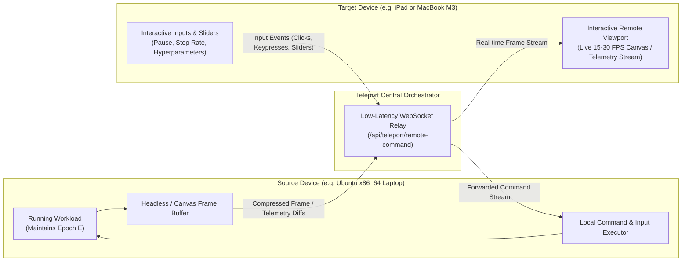

# Core Specification: Remote Access Fallback & Interactive Streamer

---

## 1. Remote Access Fallback Architecture

Inspired by `refrences/neko` (virtual desktop / browser streaming over WebRTC and WebSockets), Teleport provides an autonomous **Remote Access Fallback** subsystem.

When a workload cannot be live-migrated due to:
1. **CPU ISA Incompatibility** (e.g. `x86_64` container $\to$ `arm64` phone/Mac),
2. **Hardware Lock-in** (e.g. GPU CUDA context, pinned local file descriptors),
3. **Severe Resource Constraints** (target RAM headroom $< 25\%$), or
4. **Insufficient Battery Window** ($\eta_{\text{safety}} < 1.0$),

Teleport **preserves the workload running intact on the source node** and seamlessly opens an interactive **Remote Access Viewport** on the target device.



---

## 2. Interaction & Command Forwarding Protocol

The Remote Access Viewport is not a passive read-only display. It enables bi-directional interaction between the user on the target device and the workload on the source device:

### 2.1 Remote Control Messages (`POST /api/teleport/remote-command`)
```typescript
export interface RemoteCommandMessage {
  workloadId: string;
  sourceDeviceId: string;
  targetDeviceId: string;
  action: "PAUSE" | "RESUME" | "SET_PARAMETER" | "RESTART" | "INJECT_INPUT";
  payload?: {
    paramName?: string;
    paramValue?: number | string;
    coordinates?: { x: number; y: number };
    key?: string;
  };
  timestamp: number;
}
```

### 2.2 Latency Budgets & Guarantees
- **Local Source Execution**: Zero freeze or interruption.
- **Frame Stream Latency**: P95 $< 60\text{ms}$ over local Wi-Fi.
- **Input-to-Action Feedback**: $< 80\text{ms}$.
- **Fallback Explanation**: The viewport displays an amber alert banner clearly explaining:
  > *"Live State Migration Infeasible: Target device architecture is ARM64, whereas workload requires x86_64 native kernel. Execution preserved on Source Laptop; interactive remote session engaged."*

